<picture>
  <source media="(prefers-color-scheme: dark)" srcset="https://raw.githubusercontent.com/Cesarkill/Cesarkill/output/hero-dark.svg" />
  <source media="(prefers-color-scheme: light)" srcset="https://raw.githubusercontent.com/Cesarkill/Cesarkill/output/hero-light.svg" />
  
</picture>

<b>Cesar Giacomino</b> · Desenvolvedor Web &amp; Full-Stack · Fatec Matão (DSM — 4º semestre)

#### Sobre mim

<picture>
  <source media="(prefers-color-scheme: dark)" srcset="https://raw.githubusercontent.com/Cesarkill/Cesarkill/output/about-dark.svg" />
  <source media="(prefers-color-scheme: light)" srcset="https://raw.githubusercontent.com/Cesarkill/Cesarkill/output/about-light.svg" />
  
</picture>

> **Objetivo atual.** Lançar o **EcoMap Brasil**, publicar meu primeiro app na **Play Store** e registrar minha primeira contribuição open source.

#### Tecnologias

<picture>
  <source media="(prefers-color-scheme: dark)" srcset="https://raw.githubusercontent.com/Cesarkill/Cesarkill/output/tech-dark.svg" />
  <source media="(prefers-color-scheme: light)" srcset="https://raw.githubusercontent.com/Cesarkill/Cesarkill/output/tech-light.svg" />
  
</picture>

#### Projetos

  <a href="https://github.com/Cesarkill/fatura-clara">
    <picture>
      <source media="(prefers-color-scheme: dark)" srcset="https://raw.githubusercontent.com/Cesarkill/Cesarkill/output/project-1-dark.svg" />
      <source media="(prefers-color-scheme: light)" srcset="https://raw.githubusercontent.com/Cesarkill/Cesarkill/output/project-1-light.svg" />
      
    </picture>
  </a>
  <a href="https://github.com/Cesarkill/leitor-corte-laser-wkradar">
    <picture>
      <source media="(prefers-color-scheme: dark)" srcset="https://raw.githubusercontent.com/Cesarkill/Cesarkill/output/project-2-dark.svg" />
      <source media="(prefers-color-scheme: light)" srcset="https://raw.githubusercontent.com/Cesarkill/Cesarkill/output/project-2-light.svg" />
      
    </picture>
  </a>
   
  <a href="https://github.com/ecomap-devs/semestre-4-nextjs">
    <picture>
      <source media="(prefers-color-scheme: dark)" srcset="https://raw.githubusercontent.com/Cesarkill/Cesarkill/output/project-3-dark.svg" />
      <source media="(prefers-color-scheme: light)" srcset="https://raw.githubusercontent.com/Cesarkill/Cesarkill/output/project-3-light.svg" />
      
    </picture>
  </a>
  <a href="https://github.com/ecomap-devs/semestre-4-flutter">
    <picture>
      <source media="(prefers-color-scheme: dark)" srcset="https://raw.githubusercontent.com/Cesarkill/Cesarkill/output/project-4-dark.svg" />
      <source media="(prefers-color-scheme: light)" srcset="https://raw.githubusercontent.com/Cesarkill/Cesarkill/output/project-4-light.svg" />
      
    </picture>
  </a>

#### Telemetria

<picture>
  <source media="(prefers-color-scheme: dark)" srcset="https://raw.githubusercontent.com/Cesarkill/Cesarkill/output/telemetry-dark.svg" />
  <source media="(prefers-color-scheme: light)" srcset="https://raw.githubusercontent.com/Cesarkill/Cesarkill/output/telemetry-light.svg" />
  
</picture>

Lendo os instrumentos

- **Disco de acreção:** cada partícula representa um dia do último ano; dias com mais contribuições brilham mais forte e orbitam mais perto do horizonte de eventos. As três faixas giram em velocidades keplerianas distintas (a interna gira mais rápido), com efeito Doppler simulado no limbo esquerdo.
- **Órbita:** volume de contribuições por mês em trajetória polar fechada; o farol pulsante marca o mês de maior atividade.
- **Composição espectral:** proporção de código por linguagem nos repositórios próprios.
- **Tema claro:** renderizado como chapa fotográfica negativa, à moda dos antigos catálogos astronômicos.

Arte vetorial animada em SVG puro, gerada automaticamente via GitHub Actions. Animações param se o sistema solicitar movimento reduzido (`prefers-reduced-motion`).

#### Diário de voo

<!--LOG:START-->
- `25/11` 🛰️ Transmitiu commits para [leitor-corte-laser-wkradar](https://github.com/Cesarkill/leitor-corte-laser-wkradar)
- `18/11` 🪐 Mapeou o novo setor [leitor-corte-laser-wkradar](https://github.com/Cesarkill/leitor-corte-laser-wkradar)
- `18/11` 🛰️ Transmitiu commits para [leitor-corte-laser-wkradar](https://github.com/Cesarkill/leitor-corte-laser-wkradar)
- `17/11` 🛰️ Transmitiu commits para [fatura-clara](https://github.com/Cesarkill/fatura-clara)
- `17/11` 🪐 Mapeou o novo setor [fatura-clara](https://github.com/Cesarkill/fatura-clara)
- `12/11` 🛰️ Transmitiu commits para [exercicios](https://github.com/Cesarkill/exercicios)
<!--LOG:END-->

#### Contato

  <a href="https://www.linkedin.com/in/cesar-giacomino-257520365/">
    <picture>
      <source media="(prefers-color-scheme: dark)" srcset="https://raw.githubusercontent.com/Cesarkill/Cesarkill/output/contact-linkedin-dark.svg" />
      <source media="(prefers-color-scheme: light)" srcset="https://raw.githubusercontent.com/Cesarkill/Cesarkill/output/contact-linkedin-light.svg" />
      
    </picture>
  </a>
  <a href="mailto:cesargiacomino270@gmail.com">
    <picture>
      <source media="(prefers-color-scheme: dark)" srcset="https://raw.githubusercontent.com/Cesarkill/Cesarkill/output/contact-email-dark.svg" />
      <source media="(prefers-color-scheme: light)" srcset="https://raw.githubusercontent.com/Cesarkill/Cesarkill/output/contact-email-light.svg" />
      
    </picture>
  </a>

<picture>
  <source media="(prefers-color-scheme: dark)" srcset="https://raw.githubusercontent.com/Cesarkill/Cesarkill/output/footer-dark.svg" />
  <source media="(prefers-color-scheme: light)" srcset="https://raw.githubusercontent.com/Cesarkill/Cesarkill/output/footer-light.svg" />
  
</picture>
