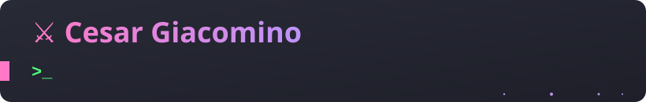

### 🛡️ Sobre o cavaleiro

Estudante de desenvolvimento na **Fatec**, forjando apps mobile com **Flutter** e sites com **React + Firebase**.
Atualmente treinando na guilda [ecomap-devs](https://github.com/ecomap-devs) e sempre em busca da próxima missão: estágio, freela ou um bom projeto open source.

### 📜 Missões ativas

```text
[████████░░]  Dominar Flutter + consumo de APIs
[██████░░░░]  Lançar o EcoMap com a guilda
[███░░░░░░░]  Publicar meu primeiro app na Play Store
[█░░░░░░░░░]  Fazer minha primeira contribuição open source
```

<br clear="right"/>

### ⚔️ Ficha de personagem

<table>
  <tr>
    <td>
      <a href="https://github.com/Cesarkill">
        
      </a>
      <a href="https://github.com/Cesarkill">
        
      </a>
    </td>
  </tr>
</table>

### 🗡️ Arsenal

| Front-end | Mobile | Back-end & dados |
| :-: | :-: | :-: |
|      |   |     |

### 🏰 Diário de batalha

<!--LOG:START-->
- `28/10` 🗡️ Forjou commits em [Cesarkill](https://github.com/Cesarkill/Cesarkill)
- `28/10` 🏰 Fundou o reino [Cesarkill](https://github.com/Cesarkill/Cesarkill)
- `28/10` 🗡️ Forjou commits em [Cesarkill](https://github.com/Cesarkill/Cesarkill)
- `28/10` ⚔️ Recrutou uma cópia de [anuraghazra/github-readme-stats](https://github.com/anuraghazra/github-readme-stats)
- `25/10` 🏰 Fundou o reino [aula11_pdm_master_detail](https://github.com/Cesarkill/aula11_pdm_master_detail)
- `25/10` 🏰 Fundou o reino [aula10_pdm_lista_api](https://github.com/Cesarkill/aula10_pdm_lista_api)
<!--LOG:END-->

### 📯 Convoque o cavaleiro

<div>
  <a href="https://www.linkedin.com/in/cesar-giacomino-257520365/" target="_blank"></a>
  <a href="mailto:cesargiacomino270@gmail.com"></a>
  <a href="https://www.instagram.com/cesar.xlr6/" target="_blank"></a>
  <a href="https://www.twitch.tv/cesargemida" target="_blank"></a>
</div>

<!--
  Para ativar, troque pelos links reais e mova para dentro do <div> acima.
  <a href="https://www.youtube.com/@SEU-CANAL" target="_blank"></a>
  <a href="https://discord.gg/SEU-CONVITE" target="_blank"></a>
-->

<picture>
  <source media="(prefers-color-scheme: dark)" srcset="https://raw.githubusercontent.com/Cesarkill/Cesarkill/output/github-contribution-grid-snake-dark.svg"/>
  
</picture>
